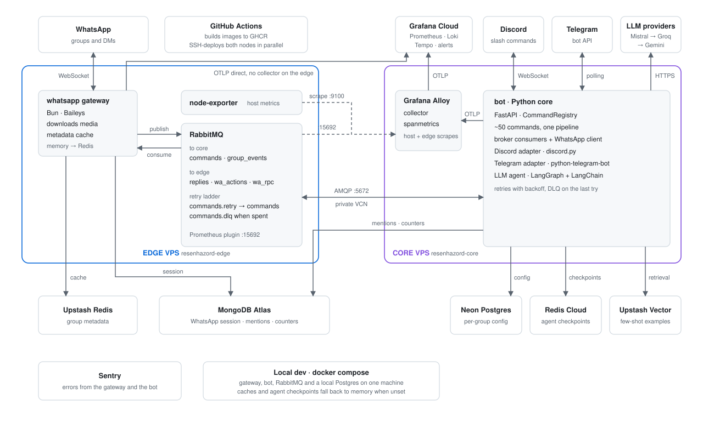

<h1 align="center"><b>🗿 Resenhazord 2️⃣</b></h1>

<p align="center">
  <a href="https://github.com/sandrosmarzaro/resenhazord2/actions/workflows/pipeline.yml?query=branch%3Amain"></a>
  <a href="https://codecov.io/gh/sandrosmarzaro/resenhazord2"></a>
  <a href="https://sonarcloud.io/summary/new_code?id=resenhazord2"></a>
  <a href="https://sonarcloud.io/summary/new_code?id=resenhazord2"></a>
  <a href="https://sonarcloud.io/summary/new_code?id=resenhazord2"></a>
  <a href="https://sonarcloud.io/summary/new_code?id=resenhazord2"></a>
</p>

<p align="center">
  <a href="https://github.com/sandrosmarzaro/resenhazord2/releases/latest"></a>
  <a href="pyproject.toml"></a>
  <a href="gateway/"></a>
  <a href="https://github.com/astral-sh/uv"></a>
  <a href="https://github.com/astral-sh/ruff"></a>
  <a href="https://www.conventionalcommits.org/"></a>
  <a href="LICENSE"></a>
</p>

<p align="center">
  
  
  
</p>

Resenhazord 2 is the chatbot of A Resenha, a group of friends who wanted memes, media downloads,
stickers, games and a bit of chaos in their chats. It answers on WhatsApp, Discord and Telegram
with the same set of about fifty commands, and it understands plain-language requests through an
LLM agent when nobody remembers the exact command.

## 💬 Platforms

| Platform | How to call it | Adapter |
|---|---|---|
| WhatsApp | `,menu` | Bun + [Baileys](https://github.com/WhiskeySockets/Baileys) gateway in `gateway/` |
| Discord | `/menu` slash command | [discord.py](https://github.com/Rapptz/discord.py) in `bot/adapters/discord/` |
| Telegram | `/menu` | [python-telegram-bot](https://github.com/python-telegram-bot/python-telegram-bot) in `bot/adapters/telegram/` |

Each platform starts only when its credentials are configured, so the bot runs with any
combination of them.

## 🧭 How it works

<p align="center">
  
</p>

All business logic lives in a Python core (FastAPI) under `bot/`, where every command is parsed
and executed through a single `CommandRegistry`. The WhatsApp gateway receives messages, downloads
their media and forwards them to the core over RabbitMQ, then delivers the replies the core sends
back. The Discord and Telegram adapters run inside the core and translate their native events into
the same command calls. In production the gateway and the broker run on an edge node and the core
on a separate node, and they deploy independently. The full flow, the project tree and the design
decisions are in [docs/architecture.md](docs/architecture.md) and [docs/adr/](docs/adr/).

## 🚀 Quick start

You need Docker with Compose. Copy the environment template, fill in the platforms you want and
start the stack.

```bash
git clone git@github.com:sandrosmarzaro/resenhazord2.git
cd resenhazord2
cp .env.example .env
docker compose up -d --build
```

The first WhatsApp start prints a pairing QR code in the gateway logs. The wiki covers every step
in detail.

- [Install](https://github.com/sandrosmarzaro/resenhazord2/wiki/Install) sets up the tools for
  running and developing the bot.
- [Run](https://github.com/sandrosmarzaro/resenhazord2/wiki/Run) configures `.env`, pairs WhatsApp
  and starts the stack.

[CONTRIBUTING.md](CONTRIBUTING.md) explains branches, commits, tests, pull requests and the rules
for AI-assisted contributions. Everyone follows the [Code of Conduct](CODE_OF_CONDUCT.md), and
vulnerabilities are reported privately as described in [SECURITY.md](SECURITY.md).

## 📚 Documentation

| Topic | Where |
|---|---|
| Architecture and message flow | [docs/architecture.md](docs/architecture.md) |
| Nodes, memory budget and dependencies | [docs/infrastructure.md](docs/infrastructure.md) |
| Branching and releases | [docs/git-flow.md](docs/git-flow.md) |
| Logging, Sentry and OpenTelemetry | [docs/logging.md](docs/logging.md) |
| Dashboards and alerts | [docs/observability-dashboards.md](docs/observability-dashboards.md) |
| Bot reply formatting | [docs/response-conventions.md](docs/response-conventions.md) |
| External API integration | [docs/api-integration.md](docs/api-integration.md) |
| Command parser regex safety | [docs/security.md](docs/security.md) |
| Architecture decision records | [docs/adr/](docs/adr/) |

## 📜 History

The first [Resenhazord](https://github.com/sandrosmarzaro/resenhazord-chatbot) was a side project
from the start of an undergraduate program, built on [Venom](https://github.com/orkestral/venom).
Resenhazord 2 began as a cleaner rewrite, moved from WWeb.js to Baileys for stability, and later
moved its business logic from TypeScript to Python so that one core could serve several platforms.

## ⚖️ License

[MIT](LICENSE)
